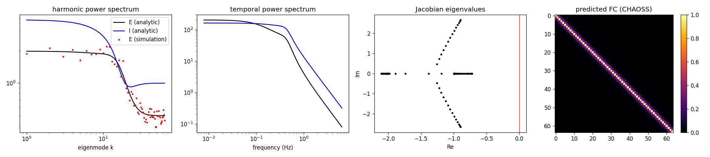

# gnf-jax

Graph neural fields in JAX: a stochastic Wilson-Cowan field on the eigenmodes of a
(connectome) graph Laplacian, with closed-form harmonic and temporal power spectra,
linear stability analysis, functional-connectivity prediction, simulation and
detrended fluctuation analysis. Everything is jit/vmap/grad compatible.

This is a JAX port of Marco Aqil's
[Graph-Stochastic-Wilson-Cowan-Model](https://github.com/marcoaqil/Graph-Stochastic-Wilson-Cowan-Model)
(MIT), the code behind

- Aqil M., Atasoy S., Kringelbach M. L., Hindriks R. (2021). *Graph neural fields: A framework for
  spatiotemporal dynamical models on the human connectome.* PLoS Comput Biol 17(1): e1008310.
  [doi:10.1371/journal.pcbi.1008310](https://doi.org/10.1371/journal.pcbi.1008310)
- Aqil M. (2026). *Brain space-time: graph neural fields capture multimodal spectra and functional
  properties of brain dynamics.* Network Neuroscience.
  [doi:10.1162/netn.a.598](https://doi.org/10.1162/netn.a.598)

Please cite those papers if you use this package.

## The model

Let `L = -(D - W)` be the (negative, combinatorial) Laplacian of a graph with eigenvalues
`lambda_k <= 0` and eigenvectors `U`. A graph kernel `K(lambda, t)` (heat kernel
`exp(t lambda)` by default, `t = sigma^2 / 2D`) acts spectrally. The field is

```
tau_e dE/dt = -d_e E + S(alpha_ee K_ee E - alpha_ie K_ie I + P) + noise_e dW
tau_i dI/dt = -d_i I + S(alpha_ei K_ei E - alpha_ii K_ii I + Q) + noise_i dW
```

with logistic `S`. Linearised about a homogeneous steady state `(E*, I*)`, each eigenmode
`k` is an independent 2-state Ornstein-Uhlenbeck process `d beta_k = -A_k beta_k dt + sqrt(D) dW`
with

```
A_k = [[ (d_e - a alpha_ee K_ee(lambda_k)) / tau_e,   a alpha_ie K_ie(lambda_k) / tau_e ],
       [ -b alpha_ei K_ei(lambda_k) / tau_i,          (d_i + b alpha_ii K_ii(lambda_k)) / tau_i ]]
a = d_e E* (1 - d_e E*),  b = d_i I* (1 - d_i I*),  D = diag((noise_e/tau_e)^2, (noise_i/tau_i)^2)
```

so the **harmonic power spectrum** (variance per mode) is the 2x2 Lyapunov solution
`A S + S A^T = D`, the **temporal power spectrum** is `2 sum_k S_k(omega)` with
`S_k(omega) = (D_ee (A_11^2 + omega^2) + D_ii A_01^2) / |det(A_k + i omega)|^2`,
and the predicted **functional connectivity** is the correlation matrix of `U diag(P) U^T`
(the CHAOSS method of the 2021 paper). Stability is read off the per-mode Jacobian
eigenvalues; `distance_to_instability` is `-max Re(lambda)`.



*`examples/grid_demo.py`: analytic vs simulated harmonic spectrum, temporal spectrum, per-mode Jacobian eigenvalues and the CHAOSS FC prediction on a 64-node chain graph.*

## Install

```
pip install git+https://github.com/m9h/gnf-jax
```

Dependencies: `jax`, `numpy`, `scipy`. Enable 64-bit mode (`jax.config.update("jax_enable_x64", True)`)
for spectra that span many decades.

## Usage

```python
import jax, jax.numpy as jnp
jax.config.update("jax_enable_x64", True)
import gnfjax as g

eigs, U = g.grid_laplacian_eigensystem(64)           # or g.laplacian_eigensystem(W) for a connectome
params = g.GNFParams(alpha_ee=20., alpha_ie=15., alpha_ei=15., alpha_ii=5.,
                     p=-5., q=-8., sigma_ee=2., sigma_ie=2., sigma_ei=2., sigma_ii=2.,
                     tau_e=1., tau_i=0.5)

states, valid = g.steady_states(params)              # multi-start Newton, deduplicated
ess, iss = states[valid][0]
print(g.classify_steady_state(params, eigs, ess, iss))   # 2 = stable, oscillatory
print(g.distance_to_instability(params, eigs, ess, iss))  # > 0 if stable

p_e, p_i = g.harmonic_spectrum(params, eigs, ess, iss)        # (N,), (N,)
omegas = jnp.linspace(0, 40, 801)
s_e, s_i = g.temporal_spectrum(params, eigs, ess, iss, omegas)  # (n_omega, N)
fc = g.functional_connectivity(U, p_e)

beta_e, beta_i = g.simulate_linearised(params, eigs, ess, iss, jax.random.PRNGKey(0),
                                       dt=1e-3, n_steps=100_000, downsample=10)
E, I = g.simulate_nonlinear(params, eigs, U, ess, iss, jax.random.PRNGKey(1), dt=1e-3, n_steps=10_000)
h = g.dfa_exponent(beta_e.T, window_sizes=[16, 32, 64, 128, 256, 512])  # DFA per mode
```

Fitting to empirical spectra follows the original objective (`Full_Analysis`): an affine map from
the model's E and I spectra onto the empirical one, a log-L2 distance plus a log-slope distance,
best stable steady state wins, unstable parameter sets get a large penalty:

```python
loss = g.spectral_loss(params, eigs, omegas, target_harmonic=emp_hps[2:], target_temporal=emp_tps, first_k=2)
grad = jax.grad(g.spectral_loss)(params, eigs, omegas, emp_hps[2:], emp_tps, first_k=2)
```

`spectral_loss` is a plain function of a `GNFParams` NamedTuple, so it drops into
`scipy.optimize.differential_evolution` (what the original fits used) or any JAX optimiser.

## Mapping from the original code

| original (`core/analysis.py`, `core/simulation.py`) | gnfjax |
|---|---|
| `GraphKernel` | `graph_kernel`, `damped_wave_kernel` |
| `one_dim_Laplacian_eigenvalues` | `grid_laplacian_eigensystem`, `laplacian_eigensystem` |
| `H_Simple_Steady_State` | `steady_states`, `steady_state_residual` |
| `GraphWC_Jacobian_TrDet` | `linearise`, `jacobian_eigenvalues`, `classify_steady_state`, `distance_to_instability` |
| `Graph_WC_Spatiotemporal_PowerSpectrum(Spatial_Spectrum_Only=True)` | `harmonic_spectrum`, `mode_covariance` |
| `Graph_WC_Spatiotemporal_PowerSpectrum(Spatial_Spectrum_Only=False)` | `temporal_spectrum`, `model_temporal_spectrum` |
| `Functional_Connectivity` | `functional_connectivity` |
| `NF_to_empirical`, `find_scaling` | `affine_combination`, `scale_to_empirical` |
| `Full_Analysis` | `spectral_loss` |
| `Linearized_GLDomain_Wilson_Cowan_Model` | `simulate_linearised` |
| `Graph_Wilson_Cowan_Model` | `simulate_nonlinear` |
| `test/test_dfa_e.py` (fathon) | `dfa_exponent` |

Every analytic quantity is regression-tested against values produced by the original numpy code
(`tests/data/gnf_reference.npz`, generated by `tests/data/make_reference_fixture.py`), and the
spectra are additionally checked against the Lyapunov identity, the Wiener-Khinchin integral and
Euler-Maruyama simulations of both the linearised and the full nonlinear field.

One deliberate difference: the original's explicit formula for the excitatory harmonic spectrum
assumes equal E and I noise amplitudes (its fits always used `sigma_noise_e = sigma_noise_i = 1`),
whereas `harmonic_spectrum` solves the general 2x2 Lyapunov equation, so it stays exact for unequal
noise. The two agree whenever the noise amplitudes are equal.

Not ported: the connectome construction from raw mesh + tractography files
(`construct_fibers_from_data`, `construct_adjacency_matrix_from_data`) and the plotting code.
Build the weighted adjacency however you like and pass it to `laplacian_eigensystem`.

## Tests

```
pip install -e ".[dev]"
python -m pytest
```
